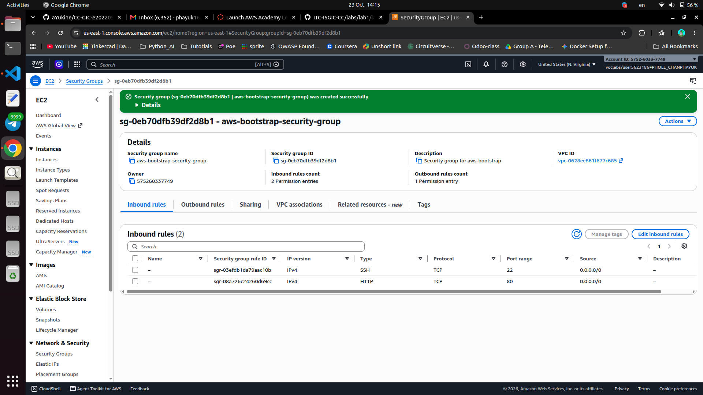
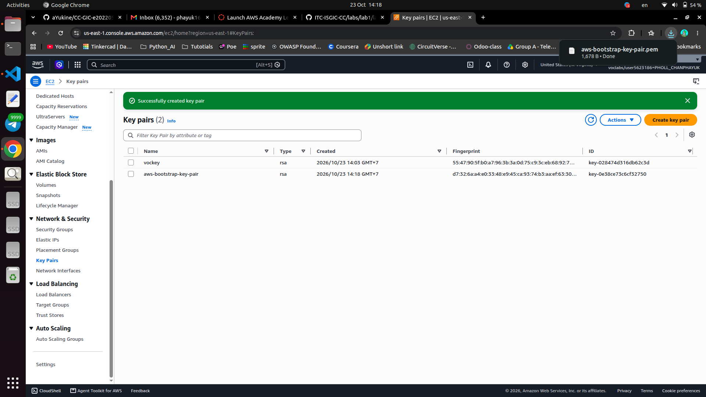
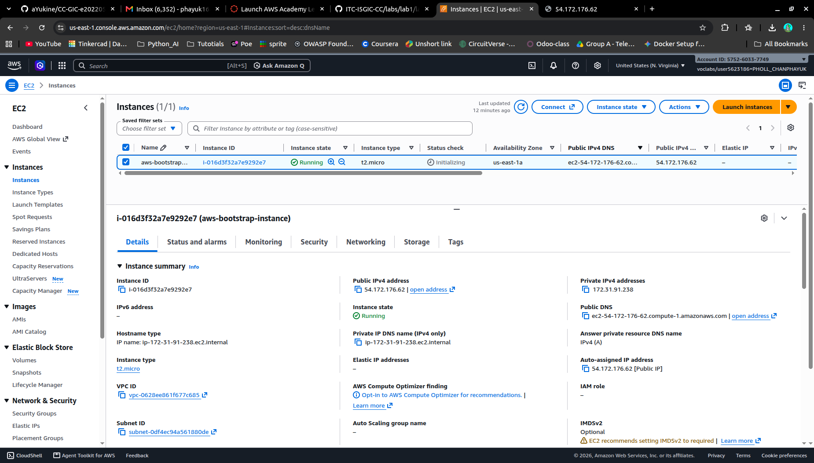
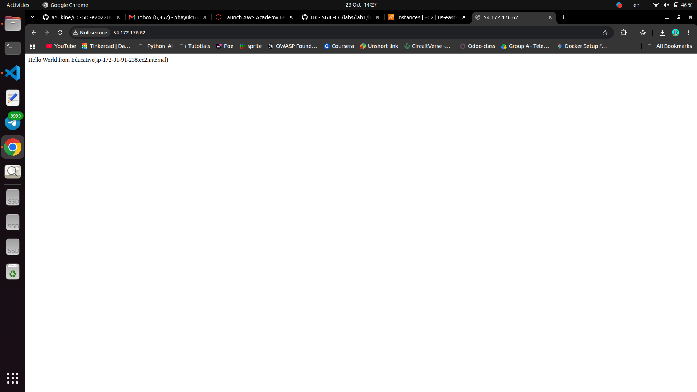
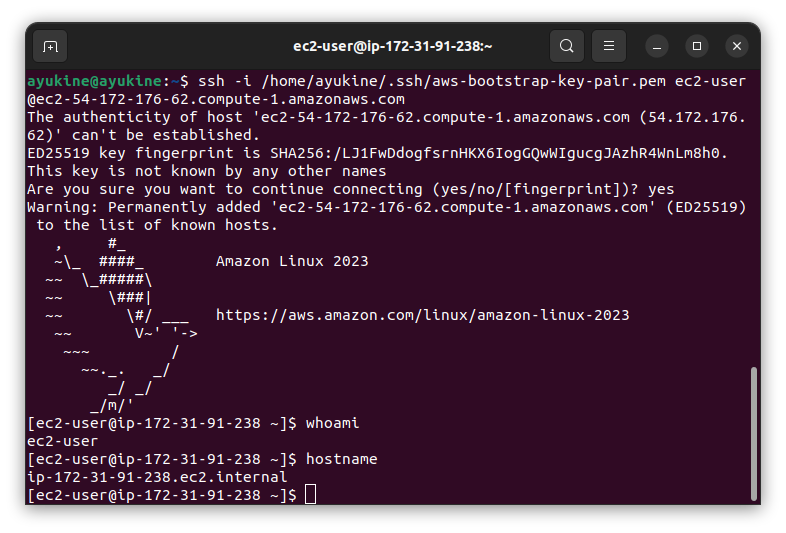
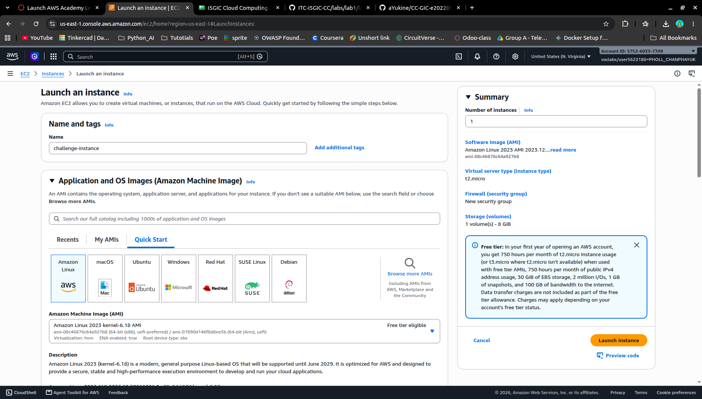
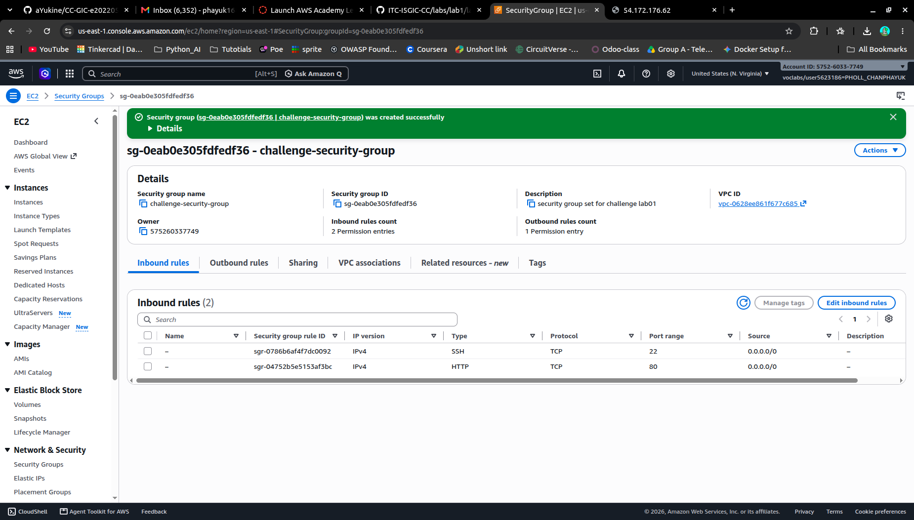
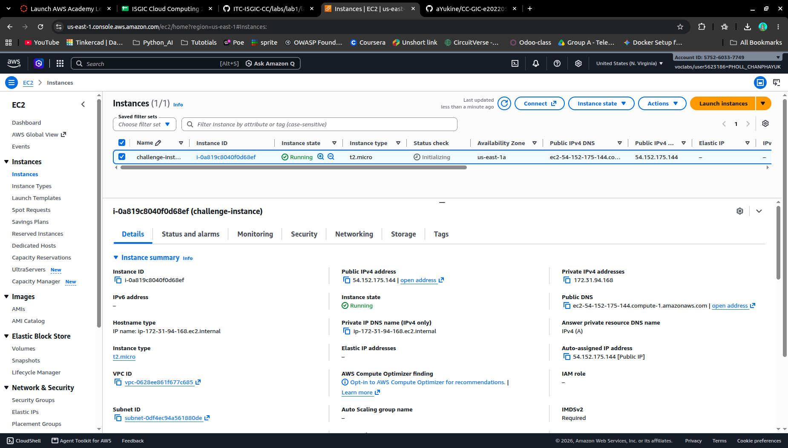
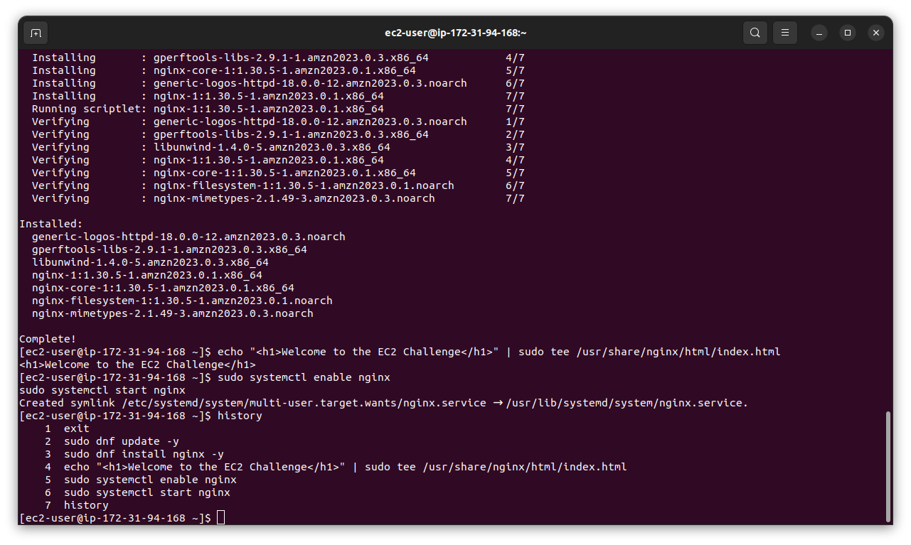
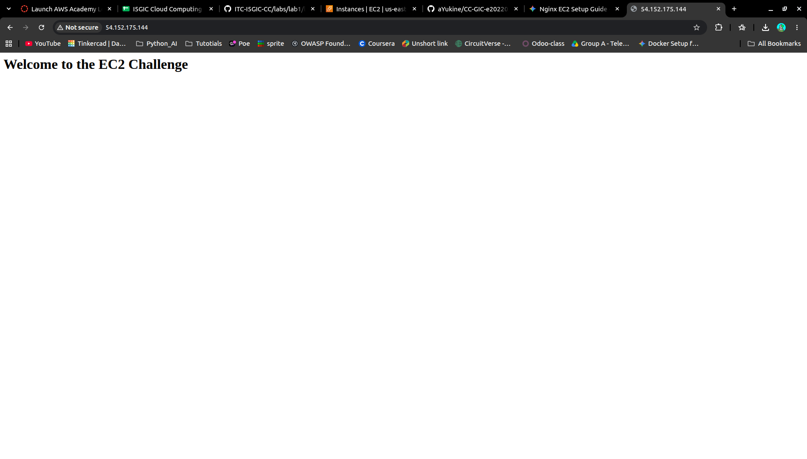

# Cloud Lab 1 Submission — Amazon EC2

Copy this template to `cc-lab-YOUR_ID/lab1/README.md` in your own repository. Follow [the instructions](lab1-instruction.md). Put your screenshots in `lab1/images/` with the file names below.

- **Student name: PHOLL CHANPHAYUK**
- **Student ID: e20220554**
- **Learner Lab user name: PHOLL CHANPHAYUK**
- **Date completed: 24 OCT 2026**

---

## Part 1.1 — An Amazon EC2 Walkthrough

### Security group



### Key pair



### Instance details



### Browser test



### SSH connection



Did you connect with your own SSH client or with EC2 Instance Connect?

---

## Part 1.2 — EC2 Web Solution (Challenge)

### Launch configuration



### Security group



### Running instance



### Commands on the instance



Paste the commands you ran to install the web server and create `index.html`:

```bash
sudo dnf update -y
sudo dnf install nginx -y
echo "<h1>Welcome to the EC2 Challenge</h1>" | sudo tee /usr/share/nginx/html/index.html
sudo systemctl enable nginx
sudo systemctl start nginx
```

### Browser test



---

## Questions

1. Your security group has an SSH rule and an HTTP rule. What does each one let you do? What would stop working if you deleted the HTTP rule?
2. In Part 1.1 you never logged in to install the web server. What installed it, and when did it run?
3. Why does the web page open with `http://` but not with `https://`?
4. Part 1.2 asked for a 10 GiB root volume. Where in the launch settings did you set it, and how can you check the size on the running instance?

## Answers

1. The SSH rule allows me to connect to the instance via SSH at port 22 and HTTP allow the website access at port 80. if HTTP rule is deleted, the website will not be accessible.  
2. The web server was installed with user data script that runs when the instance is launched.  
3. The web page opens with `http://` because the web server is configured to serve content over HTTP. It does not support HTTPS because it does not have an SSL/TLS certificate installed.  
4. The 10 GiB root volume was set in the "Configure Storage" section of the launch settings. You can check the size on the running instance by using the `lsblk` command when connected to the instance terminal or by checking the instance details in storage menu in the AWS Console.  

## Problems and how I solved them (optional)

## AI note (optional)

One suggestion an AI tool gave you and how you checked it.

## Clean up

- [x] Part 1.1: instance terminated, key pair and security group deleted.
- [x] Part 1.2: instance terminated, security group (and key pair, if any) deleted.