# Cloud Lab 2 Submission — Load Balancer and Auto Scaling

Copy this template to `cc-lab-YOUR_ID/lab2/README.md` in your own repository. Follow [the instructions](lab2-instruction.md). Put your screenshots in `lab2/images/` with the file names below.

- **Student name: PHOLL CHANPHAYUK**
- **Student ID: e20220554**
- **Learner Lab user name: PHOLL CHANPHAYUK**
- **Date completed: 30-Oct-2026**

---

## Security groups

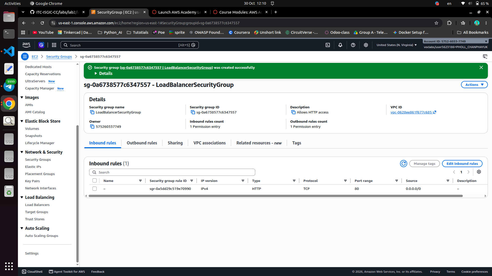

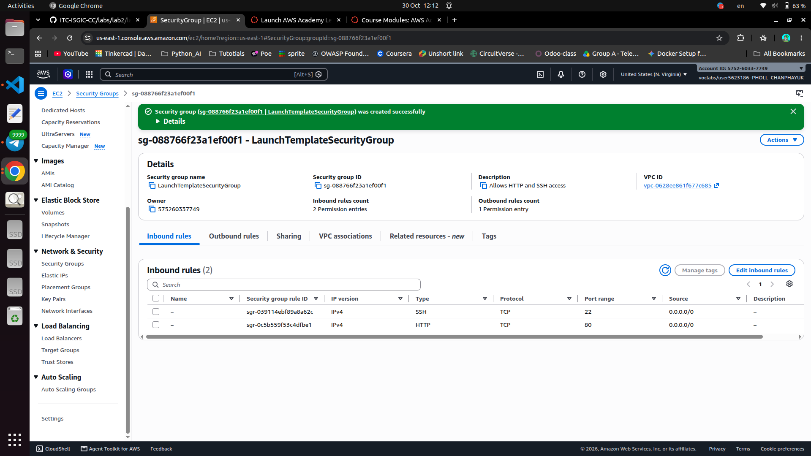

## Target group

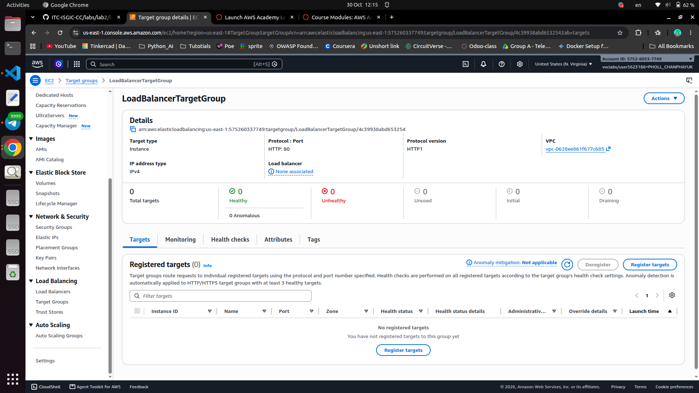

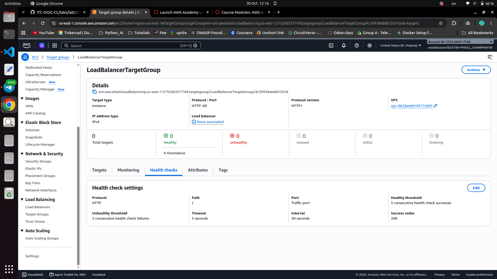

## Application Load Balancer

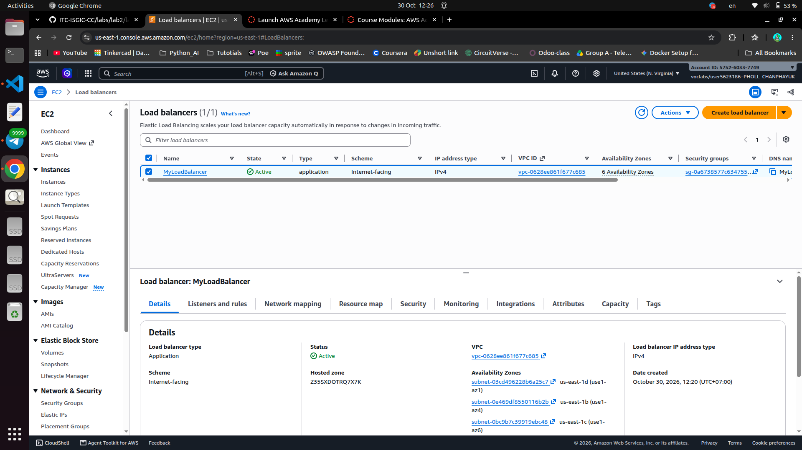

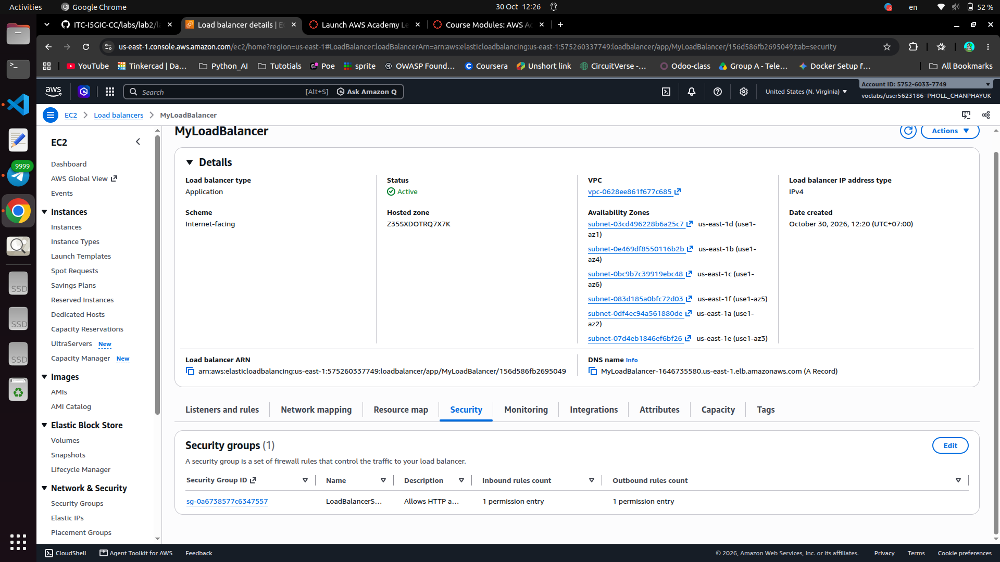

## Launch template

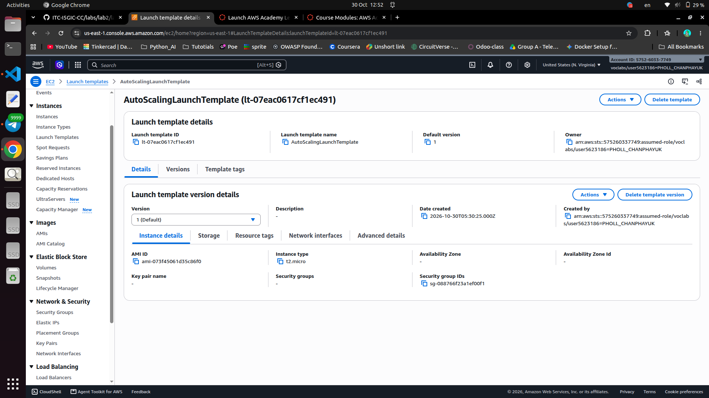
.png)

## Auto Scaling group

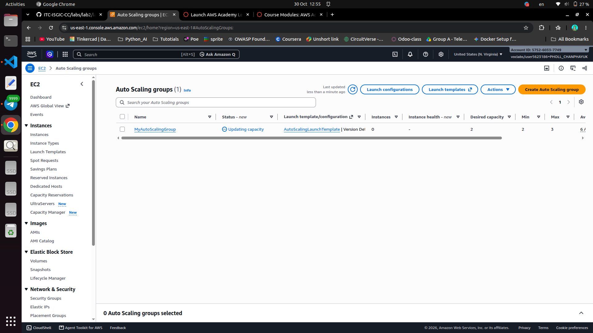

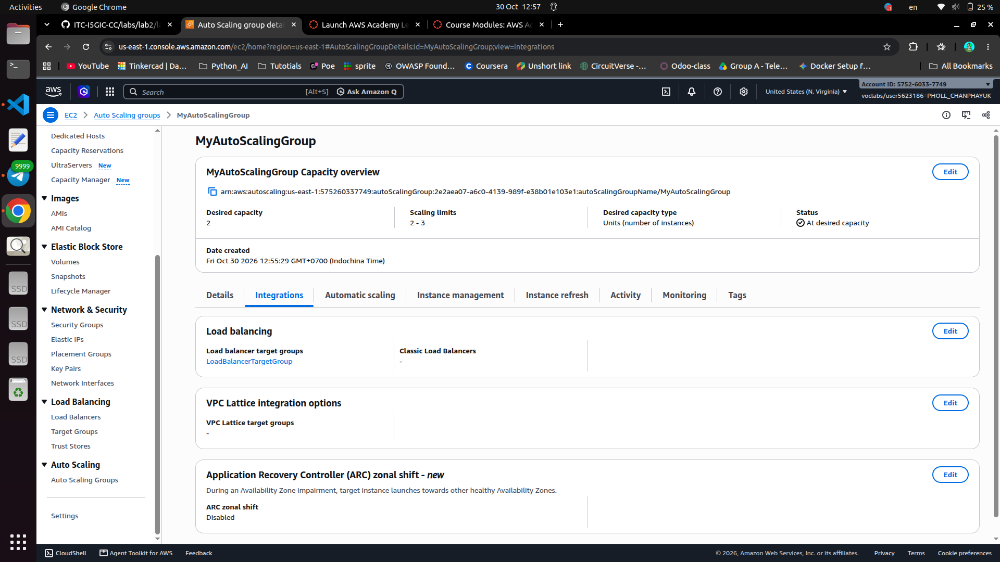

## Load balancing test

## Simulated application failure

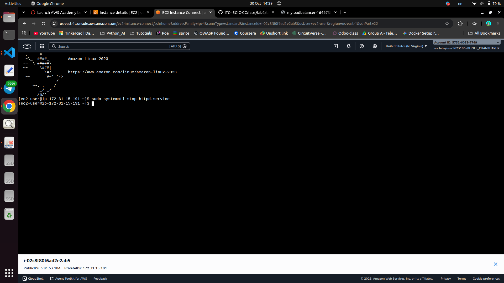

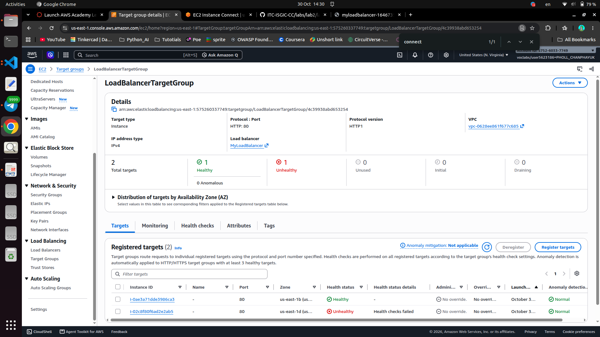

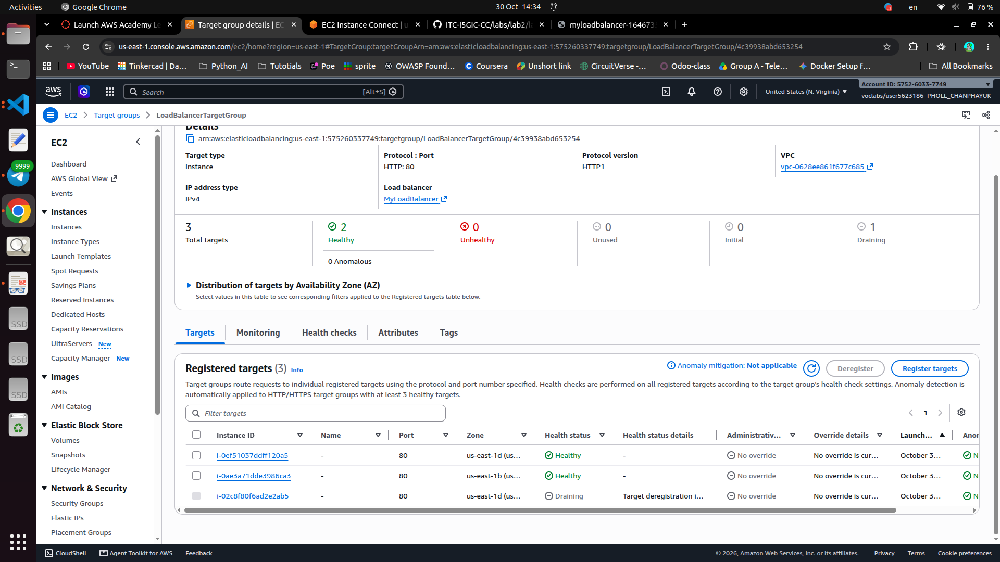

About how many minutes passed between stopping `httpd` and the new instance becoming healthy?  

answer: around 2 minutes

---

## Questions

1. Why does the page show a different host name when you refresh it?
2. After you stopped `httpd`, the instance was still *running* in EC2, but the target group marked it *unhealthy*. What did the health check test, and why did the instance fail it?
3. Who replaced the failed instance: the load balancer, the target group, or the Auto Scaling group? Explain the role of each one.
4. With desired 2, minimum 2 and maximum 3, how many instances run normally? In what situation could there be 3?
5. The instances' security group allows HTTP from anywhere. How could you change it so that the instances accept HTTP **only** from the load balancer?

## Answer

1. The load balancer sends each request to a different instance. Each instance shows its own host name, so the name changes when I refresh.

2. The health check requests `/` on port 80 and expects a `200` OK. When `httpd` was stopped, the instance was still on, but no web server answered, so the check failed and the instance was marked unhealthy.

3. The Auto Scaling group replaced it.
   - **Load balancer:** receives user requests and sends them to healthy instances.
   - **Target group:** the list of instances behind the load balancer; it runs the health checks.
   - **Auto Scaling group:** keeps the right number of instances running; it removed the unhealthy one and launched a new one.

4. Normally 2 instances run. There could be 3 when there is high traffic and the Auto Scaling group adds one more instance.

5. In the instances' security group, remove the HTTP rule from `0.0.0.0/0` and add an HTTP rule with the load balancer's security group (`LoadBalancerSecurityGroup`) as the source.

## Problems and how I solved them (optional)

## AI note (optional)

One suggestion an AI tool gave you and how you checked it.

## Clean up

- [x] `MyAutoScalingGroup` deleted and its instances terminated.
- [x] `AutoScalingLaunchTemplate` deleted.
- [x] `MyLoadBalancer` and `LoadBalancerTargetGroup` deleted.
- [x] Both security groups deleted.